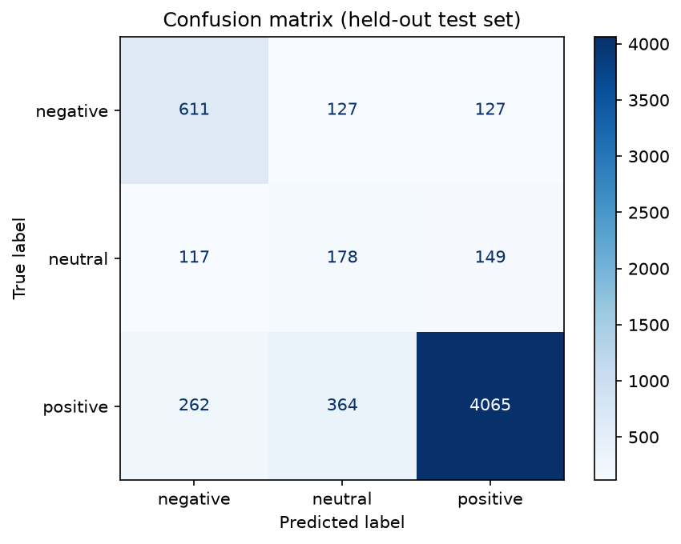

# 🍽️ Amazon Food Reviews — Sentiment Analysis

A machine learning project that classifies Amazon food product reviews into **Positive**, **Neutral**, or **Negative** sentiments using a TF-IDF + Logistic Regression pipeline.

Built as a 1st Semester ML project.

---

## 📁 Project Structure

```
1st-sem-project/
├── ml/
│   ├── data.py              # Data loading & train/test split
│   ├── preprocessing.py     # Text cleaning (HTML stripping, negation handling)
│   ├── train.py             # Model training & saving pipeline
│   ├── evaluate.py          # Metrics, classification report, confusion matrix
│   ├── predictor.py         # Inference interface (predict function)
│   └── check_integration.py # Integration & input validation tests
├── models/
│   └── sentiment_pipeline.joblib   # Trained model (TF-IDF + LogReg)
├── outputs/
│   ├── metrics.json                # Accuracy, F1 scores
│   ├── classification_report.txt   # Per-class precision/recall/F1
│   ├── confusion_matrix.csv        # Confusion matrix (CSV)
│   └── confusion_matrix.png        # Confusion matrix (plot)
├── data/
│   └── Reviews.csv                 # Amazon Fine Food Reviews dataset
├── day1.ipynb                      # Day 1: EDA & baseline
├── day2.ipynb                      # Day 2: Hyperparameter tuning
├── requirements.txt
└── README.md
```

---

## 🧠 Model & Approach

| Component | Detail |
|---|---|
| **Dataset** | Amazon Fine Food Reviews (`Reviews.csv`) |
| **Sample size** | 30,000 reviews (stratified split) |
| **Labels** | `negative` (score ≤ 2), `neutral` (score = 3), `positive` (score ≥ 4) |
| **Text Preprocessing** | Lowercase, HTML tag removal, negation expansion (`n't → not`), stop word filtering (negations preserved) |
| **Vectorizer** | TF-IDF with bigrams (`ngram_range=(1,2)`), `min_df=5`, `max_features=50,000` |
| **Classifier** | Logistic Regression (`C=1.0`, `class_weight="balanced"`, `max_iter=1000`) |
| **Train/Test split** | 80% / 20% (stratified) |

---

## 📊 Results

| Metric | Score |
|---|---|
| **Accuracy** | 80.9% |
| **Macro F1** | 0.626 |
| **Weighted F1** | 0.822 |

### Per-class Performance

| Class | Precision | Recall | F1-score | Support |
|---|---|---|---|---|
| Negative | 0.617 | 0.706 | 0.659 | 865 |
| Neutral | 0.266 | 0.401 | 0.320 | 444 |
| Positive | 0.936 | 0.867 | 0.900 | 4691 |

### Confusion Matrix



---

## 🚀 Getting Started

### Prerequisites
- Python 3.10+
- Install dependencies:

```bash
pip install -r requirements.txt
```

### Train the Model

```bash
python -m ml.train
```

### Evaluate the Model

```bash
python -m ml.evaluate
```

### Run Predictions

```python
from ml.predictor import predict

reviews = ["Absolutely loved it!", "Terrible product, never buying again."]
print(predict(reviews))
# ['positive', 'negative']
```

### Run Integration Check

```bash
python ml/check_integration.py
```

---

## 🛠️ Dependencies

Key libraries used:
- `scikit-learn` — ML pipeline, TF-IDF, Logistic Regression
- `pandas` — Data loading and manipulation
- `numpy` — Numerical operations
- `matplotlib` — Confusion matrix visualization
- `joblib` — Model serialization
- `jupyter` / `ipython` — Notebook-based EDA

See [`requirements.txt`](requirements.txt) for the full list.

---

## 👤 Author

- GitHub: [@kshmanojsingha-png](https://github.com/kshmanojsingha-png)
