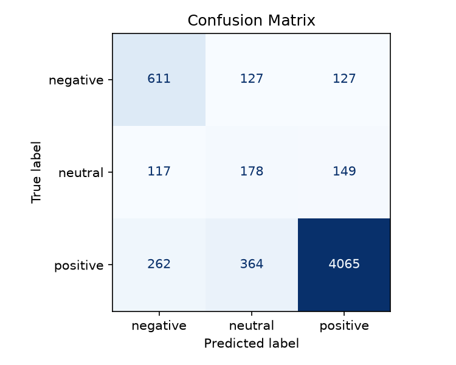
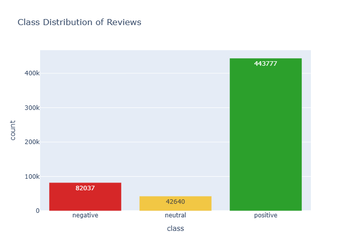

# ReviewSense - Multi-Aspect Product Review & Customer Sentiment Hub
**Group D** | Atik Hussain, Biki Sharmah, Simran Saikia, Manoj

## 1. Overview
ReviewSense reads a product review and predicts whether it is positive, neutral or negative, and tags which aspects it talks about (Quality, Shipping, Price).

## 2. Features
- Type one review and get its predicted sentiment (positive / neutral / negative)
- Rule-based aspect tags: Quality, Shipping, Price (a review can have several or none)
- CSV batch analysis with a results table and download
- Dashboard: sentiment donut chart, aspect charts, aspect filter
- FastAPI endpoint for batch predictions

## 3. Project Structure
```
ml/train.py                      trains the model and saves it with Joblib
ml/evaluate.py                   held-out test evaluation (Macro-F1, Weighted-F1, confusion matrix)
ml/predictor.py                  loads the saved model; predict(text) returns the sentiment
ml/test_cases.py                 model test cases
app.py                           Streamlit web page
simran_all_in_one.py             aspect tags, charts, evaluation visuals, tests, documentation generator
```

## 4. Installation
```
pip install -r requirements.txt
```

## 5. How to Run
```
python ml/train.py      # train and save the model
python ml/evaluate.py   # evaluate on the held-out test set
streamlit run app.py
uvicorn backend.api:app --reload   # optional API
```

## 6. Methodology
- **Dataset:** Amazon Fine Food Reviews (Kaggle), accessed 15 November 2026.
- **Size used:** 568,454 reviews. Class distribution: negative 82,037 (14.4%), neutral 42,640 (7.5%), positive 443,777 (78.1%).
- **Labels:** only the review text and the star rating are used; rating 1-2 = negative, 3 = neutral, 4-5 = positive.
- **Model:** TF-IDF + Logistic Regression (scikit-learn), saved with Joblib.
- **Metrics:** Macro-F1 (main metric, because the classes are imbalanced), Weighted-F1 and the confusion matrix, all on a held-out test set.
- **Aspect detection:** rule-based whole-word keyword matching. A review can have several aspects or none. It shows the topic, not the sentiment about that topic.

## 7. Results
Test set: 6,000 reviews. **Macro-F1 = 0.626**, **Weighted-F1 = 0.822**, accuracy = 0.809.

| Class | Precision | Recall | F1 | Support |
| --- | --- | --- | --- | --- |
| negative | 0.617 | 0.706 | 0.659 | 865 |
| neutral | 0.266 | 0.401 | 0.320 | 444 |
| positive | 0.936 | 0.867 | 0.900 | 4691 |






## 8. Testing
```
Input                                            Expected                     Actual                       Result
'The quality is excellent and very durable'      ['Quality']                  ['Quality']                  PASS  [positive]
'Product broke in two days, very poor build'     ['Quality']                  ['Quality']                  PASS  [negative]
'It is okay, nothing special'                    []                           []                           PASS  [neutral / no-aspect]
'Good quality but delivery was late'             ['Quality', 'Shipping']      ['Quality', 'Shipping']      PASS  [multi-aspect]
'Expensive, late delivery and cheap material'    ['Quality', 'Shipping', 'Price'] ['Quality', 'Shipping', 'Price'] PASS  [multi-aspect]
'Stale and expired when it arrived'              ['Quality', 'Shipping']      ['Quality', 'Shipping']      PASS  [multi-aspect (food)]
'Fresh taste, great value for money'             ['Quality', 'Price']         ['Quality', 'Price']         PASS  [multi-aspect (food)]
'Delivery was fast and the package was neat'     ['Shipping']                 ['Shipping']                 PASS  [single aspect]
'Total waste of money'                           ['Price']                    ['Price']                    PASS  [negative]
'Nice'                                           []                           []                           PASS  [no-aspect]
''                                               []                           []                           PASS  [empty input]
'PRICE is too high'                              ['Price']                    ['Price']                    PASS  [case-insensitive]
None                                             []                           []                           PASS  [None input]
123                                              []                           []                           PASS  [non-text input]

14/14 aspect tests passed

Sentiment tests using ml.predictor.predict
Input                                            Expected     Actual       Result
'Absolutely love it, works perfectly'            positive     positive     PASS
'Delicious and fresh, will buy again'            positive     positive     PASS
'Terrible, waste of money'                       negative     negative     PASS
'Awful taste, never buying this again'           negative     negative     PASS
'It is fine, average product'                    neutral      neutral      PASS

5/5 sentiment tests passed (a FAIL on 'neutral' is common for TF-IDF models - mention it under limitations)
```

## 9. Limitations & Future Work
- Keyword rules miss synonyms and sarcasm, and ignore negation ("not durable" is still tagged Quality).
- Aspect tags show the topic, not the sentiment about that topic.
- A TF-IDF model has no sense of word order, so the neutral class is the hardest.
- Future work: BERT-style model, aspect-level sentiment, more languages.

## 10. Team
Manoj - data and ML model | Atik - Streamlit UI | Biki - integration and support | Simran - testing, README, PPT, documentation
